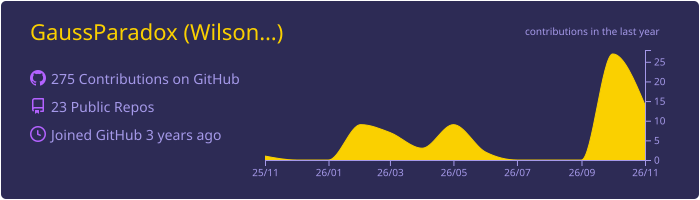
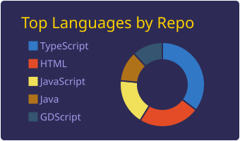
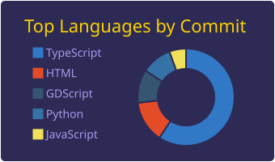
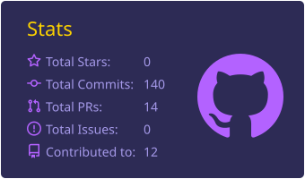
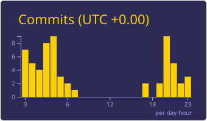

<h1 align="center">Hi there! I'm Wilson Alejandro Saavedra Arenales👋</h1>

<h3 align="center">Software Development Technologist · FESC University Student 🎓</h3>

  Web developer in training, interested in databases, clean code practices, and technology solutions that deliver real value.

---

## 🧑‍💻 About me

- 🎓 Software Development Technologist, currently pursuing a professional degree at **FESC University**.
- 🗄️ Knowledgeable in database management and querying.
- 🌐 Skilled in designing and developing web applications, applying code maintainability best practices and verification testing.
- 🤝 Known for my ability to learn, analyze, and work well in a team.
- 🤖 I use AI as a support tool (**Claude** and **ChatGPT**) to write, debug, and document code.
- 💼 Open to job opportunities where I can contribute to the development and optimization of technology solutions.

---

## 🛠️ Tech stack & tools

### Web & software development

  

### Databases

  

### Version control & project management

  
  

### Office suite

  
  
  

### Artificial intelligence

  
  

---

## 📊 My stats

  

  
  

  
  

---

  💜 Thanks for visiting my profile!

